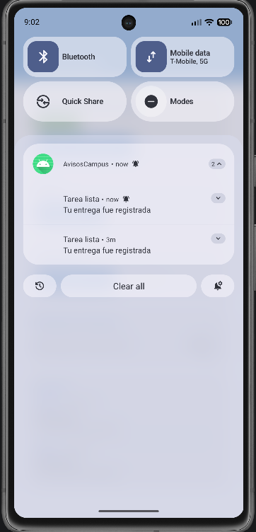
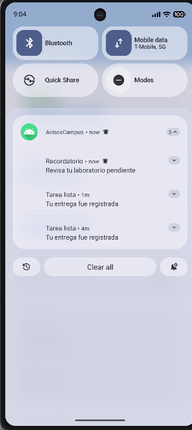
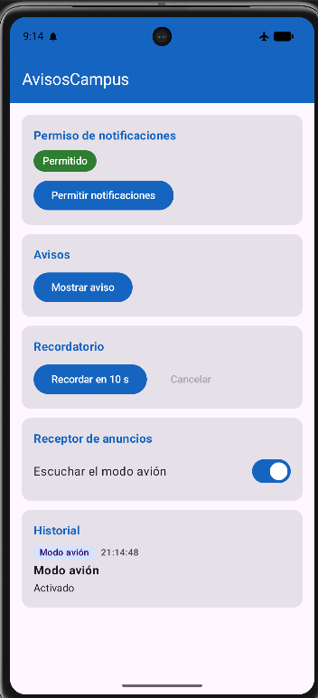
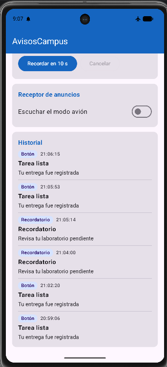
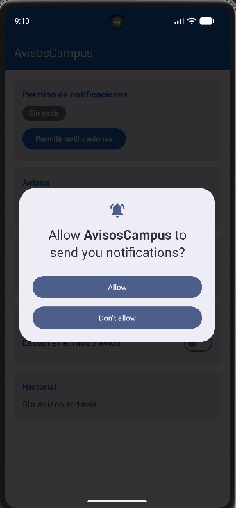

# AvisosCampus

**Laboratorio GLAB-S15 · Notificaciones en Android · Programación en Móviles (Tecsup)**

AvisosCampus es una app Android (Kotlin + Jetpack Compose + Material 3) que muestra notificaciones locales
y escucha lo que pasa en el celular:

- Con **Mostrar aviso** muestra una notificación al instante.
- Con **Recordar en 10 s** programa un recordatorio con cuenta regresiva (se puede cancelar).
- Con el switch **Escuchar el modo avión** avisa cuando se activa o desactiva el modo avión (BroadcastReceiver).
- Todo queda anotado en un **historial**, con lo más reciente arriba.
- Si el usuario niega el permiso, la app no se cierra: guarda el aviso y ofrece **Abrir ajustes**.

> Todos los datos son ficticios.

## Tecnologías

- Kotlin, Jetpack Compose y Material 3 (sin XML)
- NotificationChannel, NotificationCompat y NotificationManagerCompat
- Permiso POST_NOTIFICATIONS en tiempo de ejecución (Android 13+)
- PendingIntent para abrir la app al tocar la notificación
- Corrutinas (`viewModelScope`, `delay`, `Job`) para el recordatorio
- BroadcastReceiver registrado con `DisposableEffect`
- MVVM + Repository con StateFlow y SharedFlow

## Estructura de paquetes

```
com.ortiz.avisoscampus/
├── AvisosApp.kt                 Application: crea el canal al iniciar
├── MainActivity.kt
├── model/
│   └── Modelos.kt               Aviso, Origen, PermisoUi
├── data/
│   └── AvisosRepository.kt      interface + AvisosRepositoryMemoria
├── notificacion/
│   └── Notificador.kt           crearCanal, tienePermiso y mostrar
├── receiver/
│   └── ModoAvionReceiver.kt     escucha ACTION_AIRPLANE_MODE_CHANGED
├── viewmodel/
│   ├── AvisosViewModel.kt       permiso, avisos, recordatorio, receptor y errores
│   └── AvisosViewModelFactory.kt
└── ui/
    ├── PantallaAvisos.kt        tarjetas: permiso, avisos, recordatorio y receptor
    ├── HistorialAvisos.kt       tarjeta Historial
    └── theme/
```

## Arquitectura MVVM + Repository

```
┌───────────────────────────┐  eventos: botones, switch
│  View (PantallaAvisos)    │ ─────────────────────────────────┐
│  collectAsState()         │                                  ▼
│                           │ ◄── StateFlow ──  ┌────────────────────────────┐
│                           │  (avisos, permiso,│ ViewModel (AvisosViewModel)│
│                           │   faltan, ...)    │ decide qué avisar          │
│                           │ ◄── SharedFlow ── │ emite eventos<Aviso>       │
└────────────┬──────────────┘     (eventos)     └─────────────┬──────────────┘
             │ recibe el evento y,                            │ registra el aviso
             │ como sí tiene Context, llama a:                ▼
             ▼                                  ┌────────────────────────────┐
  Notificador.mostrar(context, aviso)           │ AvisosRepository (interface)│
  (canal + NotificationManagerCompat)           │ → AvisosRepositoryMemoria   │
                                                └────────────────────────────┘
```

| Capa | Conoce a | No debe |
|------|----------|---------|
| View (`ui/`) | Solo a su ViewModel y al Notificador | Decidir qué se avisa ni guardar el historial |
| ViewModel | Solo a la interface del Repository | Conocer Composables, recibir un Context ni mostrar notificaciones |
| Repository | Nada de la UI | Usar Context |
| Sistema (canal, NotificationManager) | — | Guardar estado de la app |

## Capturas

| Notificación en el panel | Recordatorio | Modo avión |
|:---:|:---:|:---:|
|  |  |  |

| Historial | Permiso denegado |
|:---:|:---:|
|  |  |

## Pruebas de aceptación

| Prueba | Resultado esperado | OK |
|--------|--------------------|:--:|
| Abrir Ajustes → Apps → AvisosCampus → Notificaciones | Existe el canal Avisos | ✅ |
| Pulsar Permitir notificaciones | Aparece el cuadro de Android y la etiqueta cambia | ✅ |
| Pulsar Mostrar aviso | Aparece la notificación Tarea lista | ✅ |
| Pulsar Mostrar aviso dos veces | Aparecen dos notificaciones distintas | ✅ |
| Tocar la notificación | Se abre la app y la notificación desaparece | ☐ |
| Recordar en 10 s | Cuenta regresiva y aviso al llegar a 0 | ✅ |
| Recordar y minimizar la app | El aviso llega igual | ☐ |
| Recordar y cancelar | No llega ningún aviso | ☐ |
| Switch activado y cambiar el modo avión | Aviso Activado y luego Desactivado | ☐ |
| Switch desactivado y cambiar el modo avión | No hay aviso | ☐ |
| Permiso denegado y Mostrar aviso | Mensaje de error, aviso en el historial y la app no se cierra | ☐ |
| Rotar la pantalla durante el recordatorio | La cuenta regresiva continúa | ☐ |
| Revisar el código | No hay Context en `viewmodel/` y todo receptor registrado se quita en onDispose | ✅ |

## Para pensar

**1. ¿Por qué una notificación necesita un canal y un permiso? ¿Qué pasa si falta cada uno?**
El canal agrupa las notificaciones y deja que el usuario controle su importancia desde Ajustes; desde Android 8
es obligatorio. El permiso POST_NOTIFICATIONS (Android 13+) deja que el usuario decida si la app puede avisarle.
Sin canal la notificación no se muestra; sin permiso tampoco, por eso `mostrar` devuelve false y la app lo indica.

**2. ¿Por qué el ViewModel emite un evento y no muestra la notificación él mismo?**
Porque mostrar una notificación necesita un Context y el ViewModel no debe tenerlo: vive más que la Activity
y podría filtrar memoria. El ViewModel decide qué avisar y la pantalla, que sí tiene Context, lo muestra.
Así el ViewModel se puede probar sin Android.

**3. ¿Qué pasa si usas el mismo id en dos notificaciones?**
La segunda reemplaza a la primera y solo se ve una. Por eso uso el id del aviso, que es distinto cada vez.

**4. ¿Por qué onReceive debe ser corto y por qué hay que quitar el receptor al salir?**
onReceive corre en el hilo principal: si tarda, la app se congela. Si no quito el receptor, sigue registrado
aunque la pantalla ya no exista y se filtra memoria; por eso lo quito en onDispose.

**5. ¿En qué casos usarías una notificación local y en cuáles una push de Firebase?**
Local, cuando el aviso lo genera el mismo celular: un recordatorio, una tarea terminada o un cambio del sistema.
Push, cuando el aviso viene de un servidor aunque la app esté cerrada: un mensaje nuevo, una nota publicada
o un anuncio para todos los alumnos.

## Autor

Yony Denis Ortiz Sifuentes · Tecsup · Programación en Móviles
